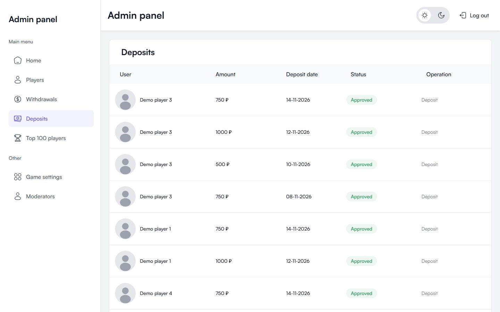

# Bottle Game Admin Panel

[](https://github.com/Dgrabovets/BottleGameAdministrationPanel/actions/workflows/ci.yml)

Admin dashboard for [Bottle Game API](https://github.com/Dgrabovets/BottleGameAPI), the backend of a Telegram mini-app game. Moderators and admins use it to watch the economy, review withdrawals and manage players. It is a portfolio project that runs against the API's demo mode. Built with Next.js 15, React 19, TypeScript and Tailwind CSS. The layout is based on the free [NextAdmin](https://nextadmin.co/) template; the unused template pages, components and images have been removed.

## Screenshots

Demo data from a local Bottle Game API.

| Dashboard | Players | Withdrawals |
|---|---|---|
|  |  |  |
| Deposits | Player profile | Game settings |
|---|---|---|
|  |  |  |

## Screens

| Route | What it does |
|---|---|
| `/` | Dashboard: balance, deposits and withdrawals, active players, profit and player growth charts with a date range |
| `/players`, `/player/[id]` | Player search, profile editing, bans, referrals, played rounds and transactions |
| `/withdraws` | Withdrawal requests: approve or reject |
| `/deposits` | Deposit history |
| `/top-players` | Top 100 players |
| `/settings` | Game parameters (win chances, multipliers, boosts) and application balance threshold |
| `/moderators` | Staff accounts (admin only) |

## How it talks to the API

The browser never receives the API token and never calls the API directly.

- `POST /api/auth/login` forwards the credentials to the API and stores the returned JWT in an `httpOnly`, `sameSite=lax` cookie. Login attempts are rate limited and requests must come from the same origin.
- All data requests go through `/api/backend/[...path]`, a server-side proxy that adds the `Authorization` header, accepts only known API paths and refuses redirects.
- `src/middleware.ts` redirects visitors without a valid session to `/login`, drops expired cookies and keeps admin-only pages (`/moderators`) away from moderators. The middleware only checks expiry; the API validates the token signature on every request.
- `next.config.mjs` sets security headers: a Content-Security-Policy, `X-Frame-Options: DENY`, `X-Content-Type-Options` and a strict `Referrer-Policy`.

## Getting started

Requirements: Node.js 20 or newer and a running Bottle Game API (see its README for a one-command Docker setup).

```bash
cd frontend
cp .env.example .env.local
npm install
npm run dev
```

The panel is served on `http://localhost:3000`. Start the API first (`docker compose up --build` in the [API repository](https://github.com/Dgrabovets/BottleGameAPI)); its demo data includes a staff account: `demo-admin@example.com` / `demo-admin-password`.

### Configuration

| Variable | Purpose |
|---|---|
| `INTERNAL_API_URL` | API base URL used by the server for login and the proxy (includes `/api`). Required in production, where the proxy refuses loopback and private hosts; in development it defaults to `http://localhost:8080/api` |
| `NEXT_PUBLIC_API_URL` | Public API URL, informational |
| `DEV_API_REWRITE_TARGET` | Optional development rewrite target for a local API with a self-signed certificate |

### Scripts

| Command | Purpose |
|---|---|
| `npm run dev` | Development server |
| `npm run build` | Production build |
| `npm run start` | Serve the production build |
| `npm run lint` | ESLint |
| `npm run typecheck` | TypeScript without emitting files |

## Project layout

```
frontend/src
  app/            routes: pages, route handlers (auth, proxy, avatar), per-page components
  components/     layout (header, sidebar), tables, form elements, shared UI
  api/            typed API clients (players, transactions, settings)
  lib/            session and security helpers, formatting, date ranges
  hooks/          session and responsive helpers
```
