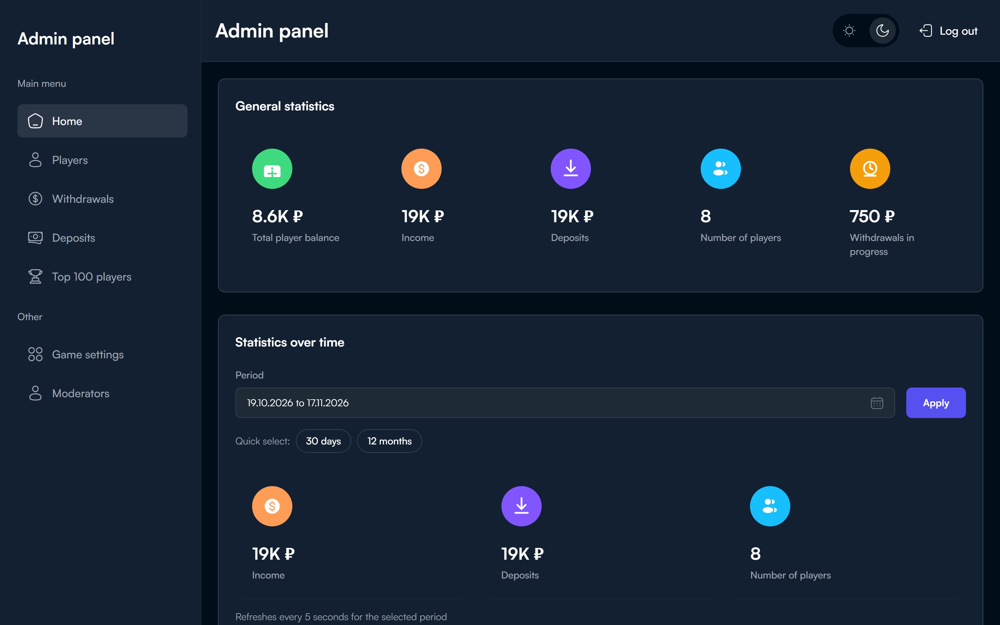
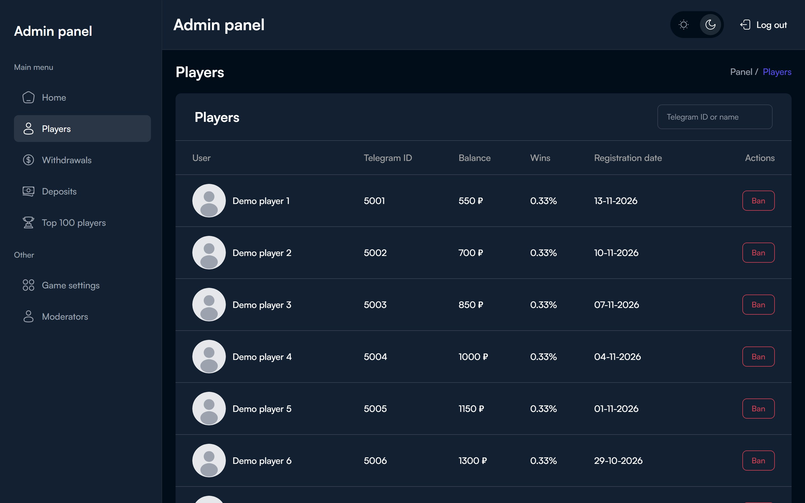
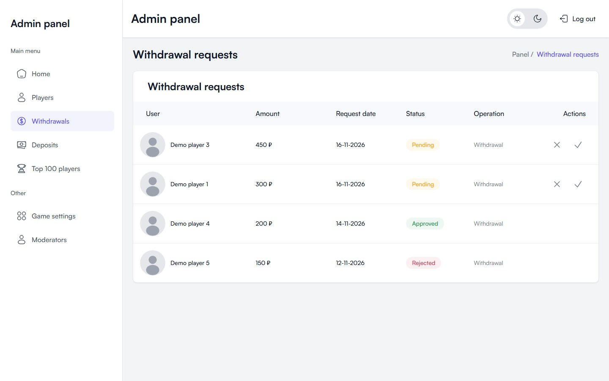
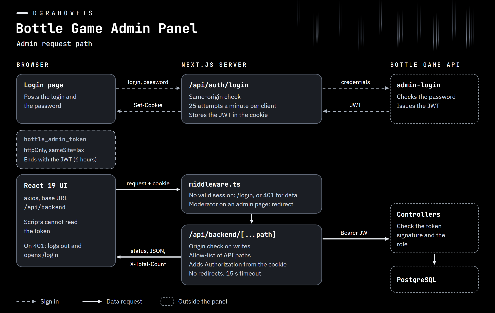

<div align="center">

# Bottle Game Admin Panel

**Back office for a Telegram mini-app game: watch the economy, review withdrawals, moderate players.**

[](https://github.com/Dgrabovets/BottleGameAdministrationPanel/actions/workflows/ci.yml)
[](https://github.com/Dgrabovets/BottleGameAdministrationPanel/actions/workflows/security.yml)
[](https://github.com/Dgrabovets/BottleGameAdministrationPanel/actions/workflows/codeql.yml)


https://github.com/user-attachments/assets/5da4cb37-b088-4421-a7e6-7d4f59bb0e52

</div>

The dashboard for [Bottle Game API](https://github.com/Dgrabovets/BottleGameAPI), the payment and game backend of a Telegram mini-app. Moderators and admins use it to follow income and deposits, approve or reject withdrawals, search and ban players, and tune the game parameters. It is a portfolio project: it runs against the API's demo mode with demo data and never touches real money.

## Highlights

- **Dashboard with live numbers.** Total player balance, income, deposits, number of players and withdrawals in progress, plus charts for any date range. It refreshes every 5 seconds.
- **Withdrawals under control.** Approve or reject a request. A status can change only once, the API enforces it.
- **Player moderation.** Search by Telegram id or name, ban and unban with a reason, and open a profile with rounds, transactions and referrals. Players, deposits and withdrawals load page by page.
- **Game tuning.** Edit win chances, multipliers and boosts, and set the lower threshold of the application balance.
- **Roles.** Admins see everything. Moderators work with withdrawals, deposits and players: they approve or reject withdrawals and ban or unban players. They cannot edit player profiles, and they do not see the dashboard statistics, the game settings or the staff list. The API enforces the same rules.
- **Safe by design.** The API token never reaches the browser, every request goes through a server-side proxy with an allow-list. See [How it talks to the API](#how-it-talks-to-the-api).
- **Dark and light themes**, responsive layout.

## Screenshots

Demo data from a local Bottle Game API.

| Dashboard | Players | Withdrawals |
|---|---|---|
|  |  |  |

| Deposits | Player profile | Game settings |
|---|---|---|
|  |  |  |

## Pages

| Route | What it does |
|---|---|
| `/` | Dashboard: player balance, income, deposits, players and withdrawals in progress, with charts for a date range (admin only, a moderator is sent to `/withdraws`) |
| `/players`, `/player/[id]` | Player search, bans, referrals, played rounds, transactions and profile editing (editing is admin only) |
| `/withdraws` | Withdrawal requests: approve or reject |
| `/deposits` | Deposit history |
| `/top-players` | Top 100 players by balance |
| `/settings` | Game parameters and the application balance threshold (admin only) |
| `/moderators` | Staff accounts (admin only) |

## How it talks to the API



The source of the diagram is `docs/diagrams/admin-request-path.svg`; `node docs/diagrams/render.mjs <fonts folder>` renders the PNG. The script runs on Windows with Microsoft Edge in its default folder, and the fonts folder must contain `JetBrainsMono[wght].ttf` and `IBMPlexSans[wdth,wght].ttf` (the variable files of [JetBrains Mono](https://fonts.google.com/specimen/JetBrains+Mono) and [IBM Plex Sans](https://fonts.google.com/specimen/IBM+Plex+Sans)).

The browser never receives the API token and never calls the API directly.

- `POST /api/auth/login` forwards the credentials to the API, gives up after 15 seconds and stores the returned JWT in an `httpOnly`, `sameSite=lax` cookie. The cookie is set for 7 days, but the API token expires after 6 hours by default (`JWT:ExpireMinutes`); the panel then drops the cookie and asks to sign in again. Login attempts are rate limited, and a request whose `Origin` (or, without it, `Referer`) header names another host is rejected. A request with neither header is accepted.
- All data requests go through `/api/backend/[...path]`, a server-side proxy that adds the `Authorization` header, accepts only known API paths, applies the same origin check to requests that change data, refuses redirects and gives up after 15 seconds. In production it also refuses an API URL whose host is written as `localhost`, a `.local` name or a loopback or private IP address. It does not resolve DNS names, and the login route does not make this check.
- `src/middleware.ts` redirects visitors without a valid session to `/login`, drops expired cookies and keeps the admin-only pages (`/`, `/settings`, `/moderators`) away from moderators. The middleware only checks expiry; the API validates the token signature on every request.
- `next.config.mjs` sets security headers: a Content-Security-Policy, `X-Frame-Options: DENY`, `X-Content-Type-Options` and a strict `Referrer-Policy`.
- Player avatars are fetched through `/api/avatar`, which accepts only `https://t.me` and `https://telegram.org` links and rebuilds each address on that fixed origin. It follows three redirects at most, only over HTTPS to Telegram hosts, allows only JPEG, PNG, GIF and WebP images (no SVG) and stops a download over 2 MB or longer than 10 seconds.

## Getting started

Requirements: Node.js 20 or newer and Docker for the API.

1. Start the API with demo data (one command, see the [API repository](https://github.com/Dgrabovets/BottleGameAPI)):

   ```bash
   docker compose up --build
   ```

2. Start the panel:

   ```bash
   cd frontend
   cp .env.example .env.local
   npm install
   npm run dev
   ```

3. Open `http://localhost:3000` and sign in with the demo staff account from the API demo data: `demo-admin@example.com` / `demo-admin-password`.

### Configuration

| Variable | Purpose |
|---|---|
| `INTERNAL_API_URL` | API base URL used by the server for login and the proxy (includes `/api`). In production this or `NEXT_PUBLIC_API_URL` must be set, and the proxy refuses `localhost`, `.local` names and loopback or private IP addresses; in development it defaults to `http://localhost:8080/api` |
| `NEXT_PUBLIC_API_URL` | Used only when `INTERNAL_API_URL` is empty |
| `DEV_API_REWRITE_TARGET` | Optional development rewrite target for a local API with a self-signed certificate |

### Scripts

| Command | Purpose |
|---|---|
| `npm run dev` | Development server |
| `npm run build` | Production build |
| `npm run start` | Serve the production build |
| `npm run lint` | ESLint |
| `npm run typecheck` | TypeScript without emitting files |

## CI and security checks

- `ci.yml`: install, lint, type check and build on every push to `main` and every pull request.
- `security.yml` (Dependency audit): `npm audit` for high and critical vulnerabilities on every pull request, every push to `main` and every Monday, plus a review of the dependencies a pull request adds.
- `codeql.yml`: GitHub CodeQL static analysis of the TypeScript code on the same schedule.
- Dependabot checks the npm packages and the GitHub Actions every week. The React and Next.js group and the tooling group each get one pull request; every other npm package and every action gets its own. Major npm versions are left for manual upgrades, because a jump in Next.js, React or Tailwind needs a migration.

## Known limitations

- The login rate limit of the panel (25 attempts a minute per client, kept in memory) takes the client address from the first value of `X-Forwarded-For`, or from `X-Real-IP`. A client can forge these headers and get past the limit unless a reverse proxy in front of the panel overwrites them.
- The panel does not forward the client address to the API, so the API's own sign-in limit counts all panel users as one client. One client that keeps trying can keep sign-in blocked for everyone.
- The referrals table of a player profile shows a win rate of 0%, because the API does not load the rounds of invited players.

## Project layout

```
frontend/src
  app/            routes: pages, route handlers (auth, proxy, avatar), per-page components
  components/     layout (header, sidebar), tables, form elements, shared UI
  api/            typed API clients (players, transactions, settings)
  lib/            session and security helpers, formatting, date ranges
  hooks/          session and responsive helpers
docs/
  screenshots/    images used in this README and in the demo video
  diagrams/       source and image of the request path diagram
  demo/           the Remotion project that renders the demo video
```

## Demo video

The 36-second walkthrough at the top is hosted as a GitHub attachment, so the repository stays small. It was rendered at 60 frames per second with [Remotion](https://www.remotion.dev/) from screenshots of the running panel and recolored afterwards. `docs/demo/source` holds a newer composition, which renders a different video, and the script that captures new screenshots through Chrome DevTools Protocol.

To capture new screenshots, start the panel on `http://localhost:3000` against the demo API and run the script (Windows, Google Chrome in its default folder, Node.js 22 or newer):

```bash
node docs/demo/source/capture-screenshots.mjs <spare folder> <frames folder> <temporary Chrome profile folder>
```

It writes PNG files to the frames folder. The first folder is created but stays empty, and the profile folder is **deleted** at the start. The script does not update `docs/screenshots`: to refresh it, convert the `dashboard`, `players`, `player`, `withdrawals`, `deposits` and `settings` frames to JPEG and copy them there.

To render the composition, create `docs/demo/source/public` with the images from `docs/screenshots`, `Satoshi-Medium.woff2` and `Satoshi-Bold.woff2` from `frontend/src/fonts`, and [JetBrains Mono](https://fonts.google.com/specimen/JetBrains+Mono) and [IBM Plex Sans](https://fonts.google.com/specimen/IBM+Plex+Sans) saved as `JetBrainsMono.ttf` and `IBMPlexSans.ttf` (the variable files). Then run:

```bash
cd docs/demo/source
npm install
npx remotion render src/index.ts AdminDemo ../admin-panel-demo.mp4
```

## License

The code is under the [MIT License](LICENSE). Two parts come from others and are not covered by it:

- The layout started from the free [NextAdmin](https://nextadmin.co/) template by [NextAdminHQ](https://github.com/NextAdminHQ/nextjs-admin-dashboard). Unused template pages, components and images have been removed, and the parts the panel still uses, such as the layout, the theme and the shared components, have been adapted for this project. The authors describe the template as free and open source, but its repository has no licence file, so whatever remains of it stays under their terms.
- The Satoshi font in `frontend/src/fonts` is copyright Indian Type Foundry and comes under the [Fontshare terms](https://fontshare.com/terms).
