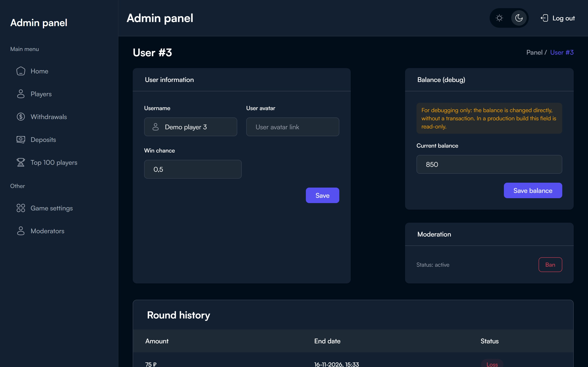
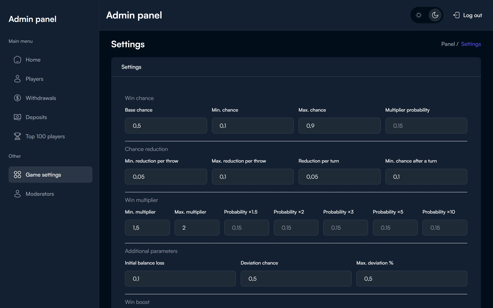
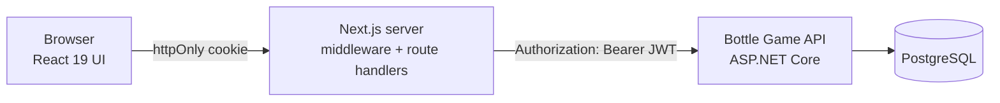

<div align="center">

# Bottle Game Admin Panel

**Back office for a Telegram mini-app game: watch the economy, review withdrawals, moderate players.**

[](https://github.com/Dgrabovets/BottleGameAdministrationPanel/actions/workflows/ci.yml)


<a href="docs/demo/admin-panel-demo-share.mp4">
  
</a>

[Watch the 53-second walkthrough](docs/demo/admin-panel-demo-share.mp4)

</div>

The dashboard for [Bottle Game API](https://github.com/Dgrabovets/BottleGameAPI), the payment and game backend of a Telegram mini-app. Moderators and admins use it to follow income and deposits, approve or reject withdrawals, search and ban players, and tune the game parameters. It is a portfolio project: it runs against the API's demo mode with demo data and never touches real money.

## Highlights

- **Dashboard with live numbers.** Balance, deposits, income, active players and pending withdrawals, plus growth charts for any date range. It refreshes every 5 seconds.
- **Withdrawals under control.** Approve or reject a request. A status can change only once, the API enforces it.
- **Player moderation.** Search by Telegram id or name, ban and unban with a reason, and open a profile with rounds, transactions and referrals.
- **Game tuning.** Edit win chances, multipliers and boosts, and set the lower threshold of the application balance.
- **Roles.** Admins see everything, moderators do not see game settings or the staff list.
- **Safe by design.** The API token never reaches the browser, every request goes through a server-side proxy with an allow-list. See [How it talks to the API](#how-it-talks-to-the-api).
- **Dark and light themes**, responsive layout.

## Screenshots

Demo data from a local Bottle Game API.

| Dashboard | Players | Withdrawals |
|---|---|---|
|  |  |  |

| Deposits | Player profile | Game settings |
|---|---|---|
|  |  |  |

## Pages

| Route | What it does |
|---|---|
| `/` | Dashboard: balance, deposits and withdrawals, active players, income and player growth charts with a date range |
| `/players`, `/player/[id]` | Player search, profile editing, bans, referrals, played rounds and transactions |
| `/withdraws` | Withdrawal requests: approve or reject |
| `/deposits` | Deposit history |
| `/top-players` | Top 100 players by balance |
| `/settings` | Game parameters and the application balance threshold (admin only) |
| `/moderators` | Staff accounts (admin only) |

## How it talks to the API



The browser never receives the API token and never calls the API directly.

- `POST /api/auth/login` forwards the credentials to the API and stores the returned JWT in an `httpOnly`, `sameSite=lax` cookie. Login attempts are rate limited and requests must come from the same origin.
- All data requests go through `/api/backend/[...path]`, a server-side proxy that adds the `Authorization` header, accepts only known API paths and refuses redirects. In production it also refuses loopback and private hosts.
- `src/middleware.ts` redirects visitors without a valid session to `/login`, drops expired cookies and keeps the admin-only pages (`/settings`, `/moderators`) away from moderators. The middleware only checks expiry; the API validates the token signature on every request.
- `next.config.mjs` sets security headers: a Content-Security-Policy, `X-Frame-Options: DENY`, `X-Content-Type-Options` and a strict `Referrer-Policy`.
- Player avatars are fetched through `/api/avatar`, which allows only image types from known hosts, limits the size and follows a few redirects at most.

## Getting started

Requirements: Node.js 20 or newer and Docker for the API.

1. Start the API with demo data (one command, see the [API repository](https://github.com/Dgrabovets/BottleGameAPI)):

   ```bash
   docker compose up --build
   ```

2. Start the panel:

   ```bash
   cd frontend
   cp .env.example .env.local
   npm install
   npm run dev
   ```

3. Open `http://localhost:3000` and sign in with the demo staff account from the API demo data: `demo-admin@example.com` / `demo-admin-password`.

### Configuration

| Variable | Purpose |
|---|---|
| `INTERNAL_API_URL` | API base URL used by the server for login and the proxy (includes `/api`). Required in production, where the proxy refuses loopback and private hosts; in development it defaults to `http://localhost:8080/api` |
| `NEXT_PUBLIC_API_URL` | Public API URL, informational |
| `DEV_API_REWRITE_TARGET` | Optional development rewrite target for a local API with a self-signed certificate |

### Scripts

| Command | Purpose |
|---|---|
| `npm run dev` | Development server |
| `npm run build` | Production build |
| `npm run start` | Serve the production build |
| `npm run lint` | ESLint |
| `npm run typecheck` | TypeScript without emitting files |

Every push and pull request runs install, lint, type check and build in GitHub Actions.

## Project layout

```
frontend/src
  app/            routes: pages, route handlers (auth, proxy, avatar), per-page components
  components/     layout (header, sidebar), tables, form elements, shared UI
  api/            typed API clients (players, transactions, settings)
  lib/            session and security helpers, formatting, date ranges
  hooks/          session and responsive helpers
docs/
  screenshots/    images used in this README
  demo/           walkthrough video and the Remotion project that renders it
```

## Demo video

The walkthrough is rendered with [Remotion](https://www.remotion.dev/) from screenshots of the running panel. `docs/demo/source` holds the composition and the script that captures the screenshots through Chrome DevTools Protocol, so the video can be rebuilt after any UI change.

## Credits

The layout started from the free [NextAdmin](https://nextadmin.co/) template. The unused template pages, components and images have been removed and the rest rewritten for this project.
